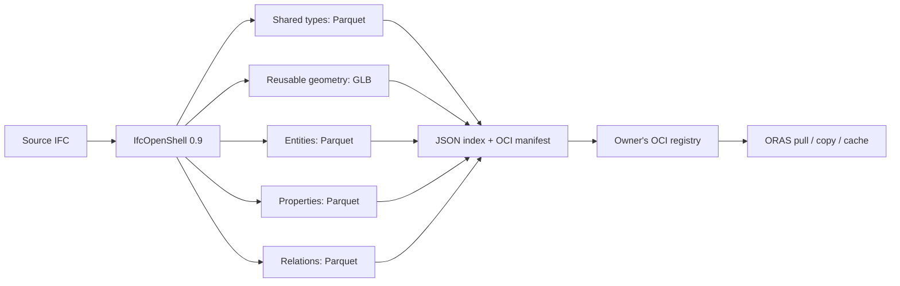

# ifcx-oci

**An IFC model release as a verifiable, portable artifact.**

This project explores an IFCX binary profile built from shared IFC types, GLB
geometry, and Parquet tables, packaged and distributed through OCI registries.
IfcOpenShell 0.9 interprets the source IFC. ORAS publishes, retrieves, caches and
copies the resulting artifact. A small JSON index defines the release's contents.

This is an experimental proposal alongside [buildingSMART's IFC5 development](https://github.com/buildingSMART/IFC5-development).
It is not a buildingSMART-approved encoding or a lossless STEP round-trip format.

The corresponding proposal is [buildingSMART IFC5-development #155: Encoding flexibility and interoperable IFC5 artifacts through OCI](https://github.com/buildingSMART/IFC5-development/issues/155).
It proposes governed encoding profiles and independently owned artifact
repositories. This repository is the implementation experiment linked from that discussion.

## Motivation

A building model passes between designers, engineers, contractors, owners and
operators. It contains geometry, properties, classifications and relationships
that change at different rates and belong to different authors. Treating every
delivery as one opaque file makes it difficult to reuse unchanged content,
retrieve only what a task needs, or establish exactly which release a decision
was based on.

The model is also more than a visualization asset. An issued IFC can form part of
a contractual delivery: the parties need to identify its precise contents,
preserve the associated schemas and supporting evidence, and distinguish a
subsequent revision from the release they accepted.

Where the original IFC is the authoritative issued document, retain it or deliver
it alongside the derived representations. This converter records its SHA-256;
it does not embed the original IFC into the artifact.

The aim is to give model releases a standard identity and delivery mechanism,
while using representations suited to their contents. Geometry belongs in a
geometry format. Entity and property data should remain accessible to analytical
tools. The packaging layer should support independent organizations and a change
in payload encoding without requiring a new distribution protocol.

## What is OCI?

The [Open Container Initiative](https://opencontainers.org/about/overview/) is an
open standards initiative formed under the Linux Foundation. Its Image and
Distribution specifications define manifests, content-addressed blobs and registry
operations. The specifications also support [artifacts beyond executable container images](https://github.com/opencontainers/image-spec/blob/v1.1.1/manifest.md#guidelines-for-artifact-usage).

For this project, an OCI artifact is a manifest describing typed files by digest
and size. A registry stores those files and manifests. An IFC artifact does not
require a container runtime to read it. [ORAS](https://oras.land/) is the client
used to transfer arbitrary artifacts through that infrastructure.

Construction can benefit from the Linux and cloud-native ecosystem's work on
interoperable registries, content verification, caching, authentication, signing
and distribution. Reusing these standards lets IFC development concentrate on
building information and model semantics. The protocols are usable across Linux,
macOS and Windows and allow organizations to select their own hosting providers.

## Why OCI fits an IFC release

- **Exact identity.** A manifest digest identifies an exact set of bytes and the
  payload descriptors it contains. A release can be referenced by digest in a
  delivery record or acceptance workflow.
- **Reuse.** Unchanged schemas, geometry and table shards keep their digests.
  Clients and registries can avoid transferring blobs they already possess.
- **Independent ownership.** Each organization can operate a compatible registry,
  control repository access, and copy an authorized release to another registry.
- **Mixed representations.** JSON, GLB, Parquet and future codecs can coexist in
  one release with explicit media types.
- **Supporting evidence.** Validation results, provenance and signatures can be
  associated with a release rather than embedded into its model data.
- **Offline delivery.** An [OCI Image Layout](https://github.com/opencontainers/image-spec/blob/v1.1.1/image-layout.md)
  carries the same content graph outside a live registry.

Digest-based identity is immutable: changing content changes its digest. A tag
such as `issued` or `latest` can still move, and a registry can delete content.
Contractual records should pin digests and have explicit retention and backup
policies. A hash alone does not establish authorship, correctness or legal status.

[Sigstore cosign](https://github.com/sigstore/cosign) can sign and verify OCI
artifacts, with key-based, identity-based and managed signing options. An issuer
could sign the release digest; recipients would verify it against an agreed trust
policy. This can bind delivery evidence to a specific model release. It does not
verify the engineering decisions or make the document legally binding by itself.
Signing is an integration opportunity; this converter does not sign artifacts or
submit private project information to public transparency services.

## Layers



| Layer | Contents | Link to the rest of the model |
| --- | --- | --- |
| Schema | Versioned column contracts and attribute-value rules | Profile URI and Parquet schema metadata |
| Shared types | One row per IFC type object | `entities.type_id → types.id` |
| Geometry | Deduplicated, local-coordinate triangle meshes in GLB | Stable representation IDs |
| Representations | Geometry ID, GLB path and node index, counts and quantization error | `entities.geometry_id → representations.id` |
| Entities | Exported IFC roots and directly referenced relationship resources | Stable ID, IFC class, attributes, type and geometry links, placement |
| Properties | Owner-specific property sets, nested groups, typed values and quantities | Owner, set, parent and path |
| Relations | One row per relationship endpoint and role | Relationship ID, target ID, role and ordinal |

The initial layers are shared type objects and reusable geometry. Occurrences
reference those definitions and supply their own placements and property ownership.
Type properties and occurrence properties retain separate owners; the converter
does not silently merge them or discard one owner's values.

OCI's `layers` field contains transfer blobs. Blob order does not specify IFC
inheritance, authoring precedence or conflict resolution. OCI transports a model;
IFC-aware consumers interpret it.

## Entity attributes contract

`entities.attributes` and `types.attributes` are required UTF-8 Parquet strings
containing JSON objects. This keeps the entity table stable across IFC classes
and schema versions, while dedicated columns expose common joins and filters.

| Field | Contract |
| --- | --- |
| `id` | Model-scoped UUID, generated from the model namespace and source GlobalId |
| `model_id` | UUID identifying the authoring model; currently derived from the source filename |
| `ifc_class` | Exact IFC entity class, for example `IfcWall` |
| `global_id` | Original IFC GlobalId, if available |
| `source_step_id` | Original STEP record ID, for provenance |
| `attributes` | Canonical JSON object of the entity's forward attributes |
| `type_id` | Assigned shared IFC type; entities only |
| `geometry_id` | Compiled reusable representation; entities only |
| `transform` | Nullable 16-value float64, column-major occurrence matrix; entities only |

Attribute keys use the exact IFC names. Inverse attributes are excluded. Scalar
strings, numbers, booleans, arrays and explicit nulls retain their JSON meanings.
The column is not a JSON-encoded string inside another JSON string:

```json
{
  "Name": "External wall",
  "Tag": "W-104",
  "PredefinedType": "STANDARD",
  "ObjectPlacement": {"$sourceRef": 123, "ifcClass": "IfcLocalPlacement"}
}
```

Additional value forms are explicit:

| Value form | Meaning |
| --- | --- |
| `{"$ref":"uuid"}` | Reference to an exported IFC root's stable ID |
| `{"$sourceRef":123,"ifcClass":"IfcLocalPlacement"}` | Source-record reference scoped by this row's `model_id`; the resource graph need not be materialized |
| `{"$ifcType":"IfcLengthMeasure","value":0.2}` | Typed IFC SELECT value |
| `{"$nonFinite":"NaN"}` | Non-finite numeric value that JSON cannot represent directly |
| `{"$integer":"9223372036854775808"}` | Integer outside signed int64 |
| `{"$binary":"base64..."}` | Binary source value |

Explicit null means the source forward attribute is absent. A missing key means
the attribute was not part of that entity's exported schema. Canonical encoding
uses sorted keys, compact separators, UTF-8 and no bare non-finite numbers. This
is the project's encoder contract, not a claim of general JSON canonicalization.

Non-root relationship endpoints also receive model-scoped IDs. Duplicate source
GlobalIds are disambiguated with STEP IDs and reported. Renaming a source file
currently changes its model namespace. A production profile needs a persistent
authoring-model identifier rather than relying on filenames.

`$sourceRef` preserves provenance without pretending the original procedural IFC
resource graph was materialized. The compiled mesh and occurrence transform are
the geometry representation consumed by this profile. Original STEP geometry,
history and other resource graphs cannot be reconstructed from this export alone.

## Property and relation contracts

Each property row has an owner, property-set identity, path and optional parent.
Complex properties have their own rows; their children point to `parent_id`.
Names and usage names remain separate. A property with no assigned value remains
present with an empty `values` list. False, zero and empty values are not treated
as missing properties.

The `values` column is a list of typed structs. Each member has a role, index and
IFC datatype, with a boolean, int64, float64, text, numeric-component list or
explicit reference slot. Lists and enumerations keep order. Table values use
`defining` and `defined` roles with corresponding row indices. Bounded values use
`lower`, `upper` and `setPoint`. Table interpolation, expressions, explicit units,
descriptions, complex properties and complex quantities have defined fields.
Complex quantities retain `Discrimination`, `Quality` and `Usage` alongside their children.
Unsupported property forms retain an explicit attribute representation rather
than disappearing silently.
IFC SELECT values retain their declared IFC type. Unwrapped quantity attributes
carry their primitive value kind; the quantity's IFC class defines the measure.

Property numbers remain in their source IFC units. Explicit units and source
project units are recorded. Geometry and occurrence translations are converted
to metres. The converter does not claim to normalize every IFC measure or
evaluate property expressions or curve interpolation.

Relations retain the IFC relationship class and forward endpoint roles, such as
`RelatingStructure` and `RelatedElements`. One endpoint per row preserves
cardinality without expanding an entire group into every possible pair. The
relationship's source attributes remain available as JSON.
Endpoint arrays are kept once in the relationship entity's attributes. Endpoint
rows carry only the remaining relationship metadata, so a group of N members
produces O(N) endpoint data rather than repeating its complete member list N times.

The generated `schema/profile.json` and Parquet metadata describe the exact
column schemas. They are release payloads generated from `contract.py`, not a
second documentation source.

## Sharding and geometry precision

The default target is **8 MiB per encoded file**. Stable IDs are hashed and
partitioned by increasingly long prefixes until a shard fits. Parquet uses Zstandard
compression; its final file size is checked before accepting a shard. GLB contains
one or more independently identified meshes. Single records or meshes larger than
the target stay intact and are flagged as oversized in the index.

This bounds change amplification without creating one OCI blob per scalar value.
The target is configurable. It is a starting point for real workloads, not a
universal optimum. Domain and spatial partitioning can precede hash sharding in
a future profile. Prefix splitting can still change membership within the split
partition; no global minimum-transfer guarantee is claimed.

Meshes use local coordinates and float32 vertex buffers. The exporter rebases
vertices before quantization, retains a float64 origin in the GLB node, and
records the maximum absolute coordinate-component error in metres. Placements stay float64 in Parquet.
Coordinates are right-handed, Y-up, in metres; IFC's Z-up placement is converted
consistently. Materials retain diffuse colour, opacity and per-face assignment.
Textures, procedural geometry, explicit normals and a full material model are
outside the initial representation.

The representation table identifies a mesh node within its GLB shard. A consumer
applies that node's local origin and the occurrence's matrix. A GLB shard is a
library of reusable meshes; it is not the fully assembled project scene.
The recorded quantization metric excludes tessellation error and any precision
loss introduced by a consumer's rendering pipeline.

## Run with uv

Python 3.13 and dependencies are resolved through uv. IfcOpenShell is pinned to
0.9.0; `uv.lock` records the dependency resolution.

```sh
uv sync
uv run pytest

# Convert one model or all .ifc files in a directory.
uv run ifcx-oci convert path/to/model.ifc --output build/model
uv run ifcx-oci convert path/to/sixty5 \
  --output build/sixty5 --shard-mib 8 --threads 4
uv run ifcx-oci verify build/sixty5

# Resume completed per-file extraction if a corpus run was interrupted.
uv run ifcx-oci convert path/to/sixty5 \
  --output build/sixty5 --resume
```

Each IFC file is extracted in a separate worker process, sequentially, to release
native memory between models. Tessellation uses the configured thread count.
SQLite is an intermediate disk spool for deduplication and partitioning. It is
not part of the release. Extraction failures stop the run; incomplete source
workers are restarted on resume. Source hashes prevent reuse after source content
changes. Missing mesh products are reported explicitly in `sources.json` and the
index; the program does not label incomplete geometry as complete.

Generated model data and intermediate files stay under ignored `build/` output.
The private fixture files are read in place and are never copied into Git.

## Publish, pull and copy

Install [ORAS](https://oras.land/docs/installation/), or set `ORAS_BIN` to an
existing executable. The CLI verifies the release before publication and after
pulling. These commands publish model data only when explicitly invoked:

Pull into a new or empty directory so obsolete shards cannot survive a release
change. `ORAS_CACHE` stores reusable blobs separately from the extracted files.

```sh
# An offline OCI layout; its path should be absolute.
uv run ifcx-oci push build/sixty5 "$PWD/build/sixty5.oci:issued" --oci-layout
uv run ifcx-oci pull "$PWD/build/sixty5.oci:issued" \
  --oci-layout --output build/offline-copy

# A private registry owned by an organization.
oras login registry.example.com
uv run ifcx-oci push build/sixty5 registry.example.com/design/sixty5:issued
export ORAS_CACHE="$PWD/.cache/oras"
uv run ifcx-oci pull registry.example.com/design/sixty5@sha256:DIGEST \
  --output build/received

# Explicit one-way copy, including OCI referrers where supported.
uv run ifcx-oci copy registry.example.com/design/sixty5@sha256:DIGEST \
  contractor.example.com/deliveries/sixty5:issued
```

All required release files are directly described by one OCI manifest. ORAS can
copy the artifact without interpreting an IFC-specific dependency graph. It
cannot automatically follow arbitrary registry URLs embedded in application JSON.
Federating separately authored domain artifacts needs an agreed assembly graph.

Use ORAS's cache for repeat pulls, and digests for pinned release references.
Copying is not a background synchronization service or a semantic merge engine.
Registry access controls, TLS, retention, backup and signature trust policy belong
to deployment. Per-blob separation within one artifact does not itself provide
per-property permissions.

## Reading the model

Parquet makes common filters and joins available without loading geometry:

```python
import json
import pyarrow.dataset as ds

entities = ds.dataset("build/sixty5/entities", format="parquet")
walls = entities.to_table(
    columns=["id", "attributes", "type_id", "geometry_id"],
    filter=ds.field("ifc_class") == "IfcWall",
)
for row in walls.to_pylist():
    print(row["id"], json.loads(row["attributes"]).get("Name"))
```

The JSON attribute column prioritizes a simple extensible entity contract. It
does not offer the same column pruning and statistics for each attribute as
dedicated Parquet columns. Frequently queried attributes can be promoted into
explicit columns in a later profile while retaining the original attribute map.

## Code structure

- `contract.py`: versioned Arrow tables and the attribute contract.
- `extract.py`: IFC interpretation, property forms, identifiers and local meshes.
- `store.py`: disk staging and size-bounded Parquet partitions.
- `geometry.py`: neutral indexed meshes to GLB shards.
- `release.py`: isolated workers, release assembly and integrity checks.
- `oci.py`: ORAS publication, independent of model interpretation.
- `cli.py`: command parsing and delegation.
- `tests/`: small generated IFC fixtures testing identity, sharing and value fidelity.

Verification checks content hashes, table schemas, canonical attributes and
cross-layer references. It is not full IFC semantic validation or full glTF
conformance certification. The exporter produces a derived model suitable for
testing the artifact architecture; it does not preserve every IFC feature.

The proposal is that buildingSMART define the model and profile semantics while
OCI supplies interoperable artifact identity and distribution. Each party can
own a registry, exchange a pinned release, and verify exactly what it received.
