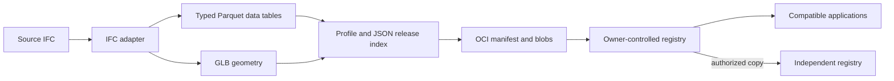

<h1><picture><source media="(prefers-color-scheme: dark)" srcset="assets/brand/subsoil-logo-chalk.svg"></picture></h1>

[Read the project pitch](https://madsolame.com/subsoil/).

**Share an IFC model release between tools and organizations through an
owner-controlled registry.**

Subsoil gives organizations control of their model data while people choose the
applications they use to work with it. A registry stores published versions;
compatible tools can open a selected version, edit it, and publish a new release.
The same connection can carry requirements, drawings, reports, and other kinds
of artifacts as applications add support for their profiles.

OCI (Open Container Initiative) provides the packaging and transfer protocol.
An **artifact profile** defines what a release contains and how its files fit
together, so different tools can interpret the same content. Access rules decide
which releases a person or application can read or publish.

The `subsoil` command runs a persistent registry, converts an IFC model into typed
Parquet data tables and GLB geometry, and publishes, receives, verifies, or copies
releases between independent registries. Its embedded browser lets people find
and share versions, then open them in a registered application.

## Try Subsoil on your computer

The following examples use the `subsoil` command. Follow the
[development guide](docs/DEVELOPMENT.md) to build it, then run commands from the
repository root.

```sh
subsoil demo --output build/showcase
```

The demo makes a small example model and shares it between two local stores. It
checks that the files arrive intact and that a person with viewing access cannot
add files or open another collection. The stores stop when it finishes. Their
data and a report remain in `build/showcase`; use a new output folder for each run.

## How the data moves



The registry keeps and delivers releases. Applications interpret models, check
requirements, and calculate results. Other artifact profiles use the same
registry API when applications understand their formats. Publication details,
including who added a version and when, are recorded separately from its
immutable content.

## Browse, share, and open a release

Open `/explore` at your registry's address and sign in. The **Files** page shows
the folders and versions you can access, with files and publication details for
each version. **Open with…** and **Edit with…** list registered applications
that support the release's profile and your permitted access. Launches reuse
your registry login; the receiving application handles editing and saving new
versions. See the [application integration guide](docs/DEVELOPMENT.md#register-applications-that-open-files)
for registration and the Open Artifact contract.

**Copy link** shares the version's browser address with someone who already has
access. Expiring share links can delegate viewing or publishing within chosen
permissions. Each named version stays fixed, so changed content receives a new
version name. An exact OCI reference and manifest are available under
**Technical details** for other tools and integrations.

## Share your own model locally

Create an account and start a local server. Choose a password of at least 12
characters when prompted.

```sh
subsoil user add --data build/company-a writer \
  --grant project/model:pull,push
subsoil serve --data build/company-a --listen 127.0.0.1:5000
```

Open `http://127.0.0.1:5000/explore` to browse the files. Keep the server running
and use a second terminal for the remaining commands.

```sh
subsoil --plain-http login 127.0.0.1:5000 \
  --username writer --scope project/model:pull,push
subsoil convert /path/to/model.ifc --output build/release --model-id design
subsoil verify build/release
subsoil --plain-http push build/release 127.0.0.1:5000/project/model:issued
```

Replace `/path/to/model.ifc` with your model's path. In these commands,
`project/model` is the folder name and `issued` is the version name. The command
line and API call these a **repository** and a **tag**. `pull` allows receiving
files; `push` allows adding them. `--plain-http` enables this local connection.

Publishing prints a content fingerprint beginning with `sha256:`. Copy the
whole value in place of `DIGEST` to receive that exact version:

```sh
subsoil --plain-http pull 127.0.0.1:5000/project/model@DIGEST \
  --output build/received
```

Receiving checks each file's size and content fingerprint, independently of
the release's profile. Run `subsoil verify build/received` when you also want
to validate a subsoil release's required files and internal structure. Both
conversion and receiving require a new output folder. Add changed content
under a new version name.

Public packages on registries such as GHCR can be received without signing in:

```sh
subsoil pull ghcr.io/ltplus-ag/ifc-lite-oci-fixtures:v1 --output build/public-model
```

Subsoil obtains an anonymous pull token when required and follows blob download
redirects without forwarding registry credentials to another origin. Anonymous
tokens remain in memory and are not saved to the sign-in file.

An account that only needs to receive files uses a `pull` grant:

```sh
subsoil user add --data build/company-a reader --grant project/model:pull
subsoil --plain-http login 127.0.0.1:5000 \
  --username reader --scope project/model:pull
```

Command-line sign-in expires after 15 minutes; run `login` again when needed.
After signing in to two stores, use `subsoil copy SOURCE DESTINATION` to copy a
version between them.

## Host public files

To host files anyone can receive, configure a public read policy. It uses the
same folder and version selectors as account policies and accepts only `pull`:

```sh
subsoil public set --data build/company-a public.json
subsoil public list --data build/company-a
```

Visitors can browse the selected files at `/explore` or pull them with an OCI
client without signing in. Downloads in the Files browser check the file's size
and content fingerprint. Publishing still requires an account. See
[public files](docs/AUTHORIZATION.md#public-files) for a policy example and how
to remove access.

## Set up a team or connect an app

The [deployment guide](docs/DEPLOYMENT.md) explains shared hosting, accounts, and
persistent storage. [Access and sharing](docs/AUTHORIZATION.md) covers account rules,
browser sign-in, and expiring links. The [development guide](docs/DEVELOPMENT.md)
explains the file format and application connection.

Subsoil's model conversion is experimental and is not buildingSMART approved.
It does not preserve every authoring detail needed to recreate the original IFC
file. Conversion includes the original IFC in the shared version by default;
use `convert --omit-source` when you only want the derived files.
`--include-source` remains accepted for existing commands. Verification checks
file integrity and internal links; your team still decides whether a model is
suitable for its project.

The [brand guide](docs/BRANDING.md) covers the logo and interface language.

Licensed under the [Apache License 2.0](LICENSE).
