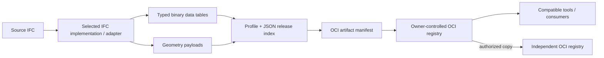

# ifcx-oci

**Share an IFC model release between tools and organizations through a common registry.**

[Read the pitch](https://madsolame.com/ifcx-oci/).

Think of a registry as a company's data reservoir. Models, requirements, drawings
and other kinds of data can each have their own tank. Different applications can
connect to that reservoir, use the data they understand, and publish new results.
New kinds of data can be added as needs grow.

OCI (Open Container Initiative) provides a common way to package and transfer
those files. Tools still need to agree on what the files mean. The aim is for
organizations to control their data while people choose the tools that suit their
work.

`ifcx-oci` is one program that can run a local registry, prepare a model release,
publish it, receive it and check that its files arrived intact. A release is a
snapshot of model data and geometry that can be shared and referred to later.

## Try the example

These examples assume `ifcx-oci` is available in your terminal. If you need to
build or set it up, see the [development guide](DEVELOPMENT.md).

```sh
ifcx-oci demo --output build/showcase
```

The demo creates a small example IFC model, starts two separate registries on
your computer, and shares the model release between them. It checks that the
received files match the published release. It also checks that a reader can
receive a release but cannot publish one or access another collection.

The result is saved in `build/showcase/demo-report.json`. The registries stop
when the demo finishes; their data and the received release stay in that folder.
Use a new output folder each time you run the demo.

## How the data moves



The registry keeps and delivers releases. Applications interpret the model,
check requirements or calculate results. Other artifact types can use the same
registry connection when the applications support their agreed format.

Connected applications can list the models your account can open and show who
published a version and when. The registry records these delivery details
separately, so the model package keeps its original identity.

## Share your own model locally

Browser applications can use the registry's own sign-in page, so they do not
collect your password. Developers can find the
[application setup](DEVELOPMENT.md#connect-a-browser-application) in the development guide.

The following example runs on your own computer. `127.0.0.1` is its local address.
Replace `/path/to/model.ifc` with the path to your IFC file.

First, create a user who can receive and publish releases in `project/model`,
then start the registry. Choose a password of at least 12 characters when asked;
it will not be shown while you type.

```sh
ifcx-oci user add --data build/company-a writer \
  --grant project/model:pull,push
ifcx-oci serve --data build/company-a --listen 127.0.0.1:5000
```

Keep that terminal open. In a second terminal, sign in:

```sh
ifcx-oci --plain-http login 127.0.0.1:5000 \
  --username writer --scope project/model:pull,push
```

Here, `project/model` names a collection of releases. `pull` means receive and
`push` means publish. A **scope** says which collection and actions a login may
use. Signing in does not give access beyond the user's permissions.
`--plain-http` enables the local connection used in this example.

Prepare, check and publish your release:

```sh
ifcx-oci convert /path/to/model.ifc --output build/release --model-id design
ifcx-oci verify build/release
ifcx-oci --plain-http push build/release 127.0.0.1:5000/project/model:issued
```

Publishing prints a fingerprint called a **digest**, beginning with `sha256:`.
Copy that whole value and replace `DIGEST` below to receive that exact release:

```sh
ifcx-oci --plain-http pull 127.0.0.1:5000/project/model@DIGEST \
  --output build/received
```

The friendly label `issued` can point to a newer release later. The digest keeps
your reference tied to the exact content you chose. Receiving a release also
checks its files. Both conversion and receiving require a new output folder.

To create a user who can only receive releases:

```sh
ifcx-oci user add --data build/company-a reader --grant project/model:pull
```

That user signs in with `--username reader --scope project/model:pull` and can
receive from the same collection. Logins last 15 minutes; sign in again when
needed. Use `ifcx-oci copy SOURCE DESTINATION` to copy a release to another
registry after signing in to both.

## Try a shared registry

You can run a small cloud test so people can connect from different computers.
Start with one registry and keep its saved data when replacing it. The
[deployment guide](DEPLOYMENT.md) covers setup and account creation.

## What to expect

This is an experimental format for sharing model data and viewing geometry. It
is not buildingSMART approved and does not preserve every authoring detail needed
to recreate the original IFC file. Your source file stays outside the shared
release unless you choose `convert --include-source`.

Verification checks that files arrived intact and that the release's data links
are consistent. Assessing who issued the model and whether it is correct for a
project still requires your own checks. Live editing and merging remain part of
the applications' workflows.

## License

Licensed under the [Apache License 2.0](LICENSE).
