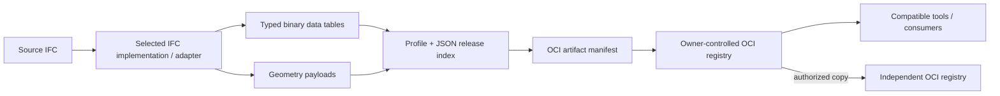

# ifcx-oci

**Share an IFC model release between tools and organizations through a common registry.**

[Read the pitch](https://madsolame.com/ifcx-oci/).

Think of a registry as a company's data reservoir. Models, requirements, drawings
and other kinds of data can each have their own tank. Different applications can
connect to that reservoir, use the data they understand, and publish new results.
New kinds of data can be added as needs grow.

OCI (Open Container Initiative) provides a common way to package and transfer
those files. Tools still need to agree on what the files mean. The aim is for
organizations to control their data while people choose the tools that suit their
work.

`ifcx-oci` is one program that can run a local registry, prepare a model release,
publish it, receive it and check that its files arrived intact. A release is a
snapshot of model data and geometry that can be shared and referred to later.

## Try the example

These examples assume `ifcx-oci` is available in your terminal. If you need to
build or set it up, see the [development guide](DEVELOPMENT.md).

```sh
ifcx-oci demo --output build/showcase
```

The demo creates a small example IFC model, starts two separate registries on
your computer, and shares the model release between them. It checks that the
received files match the published release. It also checks that a reader can
receive a release but cannot publish one or access another collection.

The result is saved in `build/showcase/demo-report.json`. The registries stop
when the demo finishes; their data and the received release stay in that folder.
Use a new output folder each time you run the demo.

## How the data moves



The registry keeps and delivers releases. Applications interpret the model,
check requirements or calculate results. Other artifact types can use the same
registry connection when the applications support their agreed format.

Connected applications can list the models your account can open and show who
published a version and when. The registry records these delivery details
separately, so the model package keeps its original identity.

## Share your own model locally

Browser applications can use a registry-owned sign-in page and OAuth
Authorization Code with PKCE, so they do not collect registry passwords. See
[development application setup](DEVELOPMENT.md#connect-a-browser-application)
or the cloud deployment example below.
The terminal examples below use the CLI's existing OCI account login.

The following example runs on your own computer. `127.0.0.1` is its local address.
Replace `/path/to/model.ifc` with the path to your IFC file.

First, create a user who can receive and publish releases in `project/model`,
then start the registry. Choose a password of at least 12 characters when asked;
it will not be shown while you type.

```sh
ifcx-oci user add --data build/company-a writer \
  --grant project/model:pull,push
ifcx-oci serve --data build/company-a --listen 127.0.0.1:5000
```

Keep that terminal open. In a second terminal, sign in:

```sh
ifcx-oci --plain-http login 127.0.0.1:5000 \
  --username writer --scope project/model:pull,push
```

Here, `project/model` names a collection of releases. `pull` means receive and
`push` means publish. A **scope** says which collection and actions a login may
use. Signing in does not give access beyond the user's permissions.
`--plain-http` enables the local connection used in this example.

Prepare, check and publish your release:

```sh
ifcx-oci convert /path/to/model.ifc --output build/release --model-id design
ifcx-oci verify build/release
ifcx-oci --plain-http push build/release 127.0.0.1:5000/project/model:issued
```

Publishing prints a fingerprint called a **digest**, beginning with `sha256:`.
Copy that whole value and replace `DIGEST` below to receive that exact release:

```sh
ifcx-oci --plain-http pull 127.0.0.1:5000/project/model@DIGEST \
  --output build/received
```

The friendly label `issued` can point to a newer release later. The digest keeps
your reference tied to the exact content you chose. Receiving a release also
checks its files. Both conversion and receiving require a new output folder.

To create a user who can only receive releases:

```sh
ifcx-oci user add --data build/company-a reader --grant project/model:pull
```

That user signs in with `--username reader --scope project/model:pull` and can
receive from the same collection. Logins last 15 minutes; sign in again when
needed. Use `ifcx-oci copy SOURCE DESTINATION` to copy a release to another
registry after signing in to both.

## Single-instance cloud test deployment

Run **one replica** behind an HTTPS cloud ingress/load balancer. Route the whole
registry hostname to container port 5000 over a private HTTP connection; expose
only HTTPS to clients. The registry does not terminate TLS itself. Configure DNS
and a valid certificate for `registry.example.com`, and register the application's
exact HTTPS callback URL, including its path and trailing slash if present.

Build the image with `docker build -t ifcx-oci:dev .`. Provision accounts with the
existing CLI by running the same distroless image as a one-off job. Its entrypoint
is the binary; no shell or admin API is needed. These examples use Docker, with
the same `/data` volume and UID/GID **65532:65532** for every job and server:

```sh
docker volume create ifcx-oci-data
docker run --rm -it --user 65532:65532 -v ifcx-oci-data:/data ifcx-oci:dev \
  user add --data /data writer
docker run --rm --user 65532:65532 -v ifcx-oci-data:/data ifcx-oci:dev \
  user grant --data /data writer project/model:pull,push

# Publish only to the local ingress; in a cloud service, use a private backend.
docker run -d --name ifcx-registry --restart unless-stopped --stop-timeout 60 \
  --user 65532:65532 -p 127.0.0.1:5000:5000 -v ifcx-oci-data:/data ifcx-oci:dev \
  serve --data /data --listen 0.0.0.0:5000 \
  --public-url https://registry.example.com \
  --oauth-client-id model-client \
  --oauth-redirect-uri https://app.example.com/oauth/callback
```

For a noninteractive cloud job, use `user add --password-stdin` and pipe a password
from your secret manager into its standard input. Passwords require at least 12
characters. `user add --grant project/model:pull,push` also provisions grants in
one job; `user grant` can add permissions later against the same mounted volume.
New persistent disks must be empty and writable by UID 65532; initialize ownership
through the platform's volume setup. Do not mount a root-owned disk over `/data`
without arranging that ownership.

Persist **all of `/data`**, including `registry.json`, `auth.sqlite` (accounts,
grants and browser sessions), `signing.key`, `blobs/` and `repositories/` (including
uploads). Keep this volume when replacing the container, and supply the same
public URL and OAuth registration to its replacement. Back up the whole directory
with the server stopped or using a consistent volume snapshot. The Docker smoke
check below verifies that accounts, grants, remembered sessions, existing bearer
tokens and pushed artifacts survive replacement on the same volume.

The public URL is an origin without credentials, path, query or fragment. It
controls authorization links, password-form Origin checks and the OCI Bearer
realm. Host and forwarded headers do not select it. HTTPS public URLs require
HTTPS callbacks; callbacks are matched exactly. HTTP is supported only with a
loopback public URL for local development. Non-loopback listeners require an
explicit public URL.

For browser applications, fetch `/oauth/config` and use Authorization Code with
PKCE S256. The password page is on the registry's public origin. Proxy the
application's `/oauth/token` and `/oauth/revoke` routes to the registry routes of
the same name. Preserve the browser's `Origin` (the registered callback's origin),
`Cookie`, form body, response status and `Set-Cookie`; do not replace Origin with
the private backend address or enable arbitrary cross-origin proxy requests.
Remembered login uses a rotating `HttpOnly; Secure; SameSite=Strict` cookie scoped
to `/oauth/`; keep those application routes under that path and serve them over
HTTPS. The proxy makes the cookie belong to the application, so refresh works
without third-party cookies. Keep access tokens in memory; remembered refresh
credentials are omitted from JSON. Consent cookies on the HTTPS registry are
also Secure even though the private hop uses HTTP.

Use unauthenticated `GET /healthz` for liveness and `GET /readyz` for readiness.
They return empty bodies: 200 when healthy, or 503 when database/storage readiness
fails. Readiness checks a database write transaction and temporary file I/O in
the data and artifact directories. Configure a modest probe interval such as 10
seconds. On SIGTERM or Ctrl+C the server stops accepting connections and drains
active requests; allow enough shutdown time for uploads (the example allows 60
seconds).

Both browser password login and OCI/CLI `/token` login share an in-memory budget
of 5 attempts per account and 60 total attempts per minute, including successes.
Throttled attempts return 429 with `Retry-After`. Restart clears this budget;
apply ingress request limits too for an internet-facing test service.

Keep replica count at **one**, including during replacement (use a recreate
strategy). Pending OAuth requests and authorization codes are in memory and are
lost on restart; users can restart sign-in. Storage mutations use a server-local
lock and assume one server, so a shared volume does not make replicas safe.
One-off account jobs use SQLite transactions; they are not additional servers.
Password reset, account disabling and administrative session revocation are
follow-up CLI work.

Verify the image and a real TLS ingress/application proxy locally:

```sh
cargo test --locked --test deployment --test oauth_sessions --test showcase
docker build -t ifcx-oci:cloud-test .
python3 tests/cloud_smoke.py ifcx-oci:cloud-test
```

The smoke check requires Docker, Python 3 and `openssl`, trusts its temporary
localhost certificate, and removes its test containers and volume. Against your
deployed hostname, run the earlier login/push/pull examples with
`registry.example.com` and omit `--plain-http`.

## What to expect

This is an experimental format for sharing model data and viewing geometry. It
is not buildingSMART approved and does not preserve every authoring detail needed
to recreate the original IFC file. Your source file stays outside the shared
release unless you choose `convert --include-source`.

Verification checks that files arrived intact and that the release's data links
are consistent. Assessing who issued the model and whether it is correct for a
project still requires your own checks. Live editing and merging remain part of
the applications' workflows.

The bundled registry supports local use and the single-instance cloud test above.
A shared team service needs an appropriately operated registry. Build and local
development commands are in [DEVELOPMENT.md](DEVELOPMENT.md).

## License

Licensed under the [Apache License 2.0](LICENSE).
