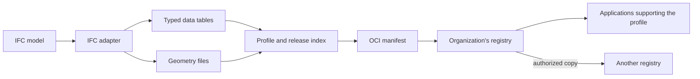

# Development

Run the commands in this guide from the repository root. Subsoil is a Rust
program that serves a file store, prepares model versions, and transfers them
between stores. Its browser pages are embedded in the binary.

## Build

The Nix development shell supplies the Rust tools and supporting programs:

```sh
nix develop
cargo build --locked --release
./target/release/subsoil --help
```

To build the packaged executable directly with Nix, run `nix build`. The result
is available as `./result/bin/subsoil`.

## Checks

The tests cover model conversion, file transfers, access rules, browser sign-in,
and persistence. Run the Rust checks, then exercise the two-store example with
ORAS and evaluate the Nix package:

```sh
cargo fmt --check
cargo clippy --locked --all-targets -- -D warnings
cargo test --locked
node --test tests/open_artifact_client.mjs
SUBSOIL_TEST_ORAS="$(command -v oras)" cargo test --locked --test showcase
nix flake check --no-build
git diff --check
```

When changing the logo, also run `python3 tools/build_brand.py --check` to check
that the exports match their masters. See the [brand guide](BRANDING.md) for
asset locations and regeneration.

## Connect a browser application

The file browser at `/explore` works without an external app registration. To
connect another browser application, register its client ID and exact callback
URL when starting Subsoil:

```sh
cargo run --locked -- user add --data build/registry writer \
  --grant project/model:pull,push
cargo run --locked -- serve --data build/registry --listen 127.0.0.1:5000 \
  --oauth-client-id model-client \
  --oauth-redirect-uri http://localhost:3000/oauth/callback
```

The application requests `subsoil:session` during PKCE sign-in, then exchanges the
approved root for concrete repository tokens at `/token`. The shared JSON policy
shape and share API are described in [AUTHORIZATION.md](AUTHORIZATION.md).

For direct browser API access, also pass `--cors-origin http://localhost:3000`.
Repeat `--cors-origin` for each trusted application origin. Registering an OAuth
callback alone does not enable CORS. See the [CORS deployment notes](DEPLOYMENT.md#direct-browser-access-with-cors)
for hosted applications and remembered-login constraints.

### Register applications that open files

Use `serve --applications /path/to/applications.json` to register profiles and
external web applications for the **Open with…** controls in the file browser
and shared-file page. Each profile has a versioned absolute identifier and an
exact pair of manifest `artifactType` and config `mediaType` values. Several
applications can support the same profile, and an application can support
several profiles. Applications interpret and validate the content themselves.

The following configuration illustrates an application implementing an example
IFC profile. Replace the profile and URLs with those your application supports:

```json
{
  "version": 1,
  "profiles": [{
    "id": "urn:example:ifc-release:1",
    "artifact_type": "application/vnd.example.ifc-release.v1",
    "config_media_type": "application/vnd.example.ifc-release.config.v1+json"
  }],
  "applications": [{
    "id": "model-editor",
    "name": "Model editor",
    "launch_url": "https://editor.example.com/open",
    "redirect_uris": ["https://editor.example.com/callback"],
    "cors_origins": ["https://editor.example.com"],
    "supports": [{
      "profile": "urn:example:ifc-release:1",
      "intents": ["view", "edit"],
      "publish": true
    }]
  }]
}
```

Launch and callback URLs share the application's origin and use HTTPS, with
loopback HTTP available for development. `cors_origins` explicitly enables API
access from the listed application origins when this configuration is loaded by
the CLI. Existing `--cors-origin` entries are combined with these origins. The
legacy `--oauth-client-id` registration can coexist with applications using
distinct IDs. Load the same configuration after restarting the server.

### Receive an Open Artifact launch

The `open-artifact/1` flow sends `issuer` and `request_id` to the registered
launch URL. Treat the request ID as a transaction locator. Accept the issuer
through your application's trusted-registry configuration before connecting.
Each application supplies its own PKCE verifier and registered callback.

The registry serves a reference ES module at `/open-artifact/client.js`. Bundle
that module with the application or import it from a trusted registry with CORS
enabled. The receiving route starts authorization:

```js
import { beginLaunch } from './open-artifact-client.js';

const query = new URLSearchParams(location.search);
const issuer = query.get('issuer');
if (!trustedRegistries.includes(issuer)) throw Error('Choose a trusted registry');
await beginLaunch({
  issuer,
  requestId: query.get('request_id'),
  clientId: 'model-editor',
  redirectUri: location.origin + '/callback'
});
```

On the callback route, `finishLaunch()` validates the state, issuer, callback
and transaction age, removes callback parameters from the URL, and exchanges the
single-use code. Its result includes `open_artifact`, `access_token`, and a
rotating `refresh_token`. Keep the result in memory. The module stores the
pending verifier and state in session storage only until the callback.

```js
import { finishLaunch, repositoryToken, renewLaunch } from './open-artifact-client.js';

let session = await finishLaunch();
const { source, intent, publish, expires_at } = session.open_artifact;
const token = await repositoryToken(session, source.repository, ['pull']);
// Use token.access_token in Authorization headers with the ordinary OCI client.
// Fetch source.digest, verify the manifest and blob digests, and interpret source.profile.
// For publication, request ['push'] for publish.repository and use an allowed new tag.
// Renew shortly before the session access token expires, serializing rotations:
session = await renewLaunch(session);
```

The protocol context contains `protocol`, `source` (registry, repository, digest,
profile), `intent`, `expires_at`, and an optional `publish` destination with
`repository` and `allowed_tags`. Publication uses the same registry and profile
as the source. An application produces and validates the resulting artifact;
the registry enforces the destination and tag permissions.

Applications using another client library can fetch
`GET /oauth/config?client_id=<application-id>` and perform the advertised PKCE
flow with `scope=subsoil:session` and `launch_request=<request-id>`. The token
response includes the same context. For custom registry interfaces,
`GET /open-artifact/applications?repository=<name>&reference=<tag-or-digest>`
lists compatible applications. `POST /open-artifact/launches` accepts
`application_id`, `repository`, `reference`, `intent`, `ttl` in seconds, and
optional `publish`; both endpoints require an account or share session root in
the Authorization header. Registry-owned share interfaces preserve the launch
response's browser cookie using `credentials: 'same-origin'`.

Each discovery result includes `launches.view` and, when permitted,
`launches.edit`. These contain suggested `intent`, `ttl`, and optional `publish`
values for the selected action. The registry's chooser sends those values
without asking for save settings. A publication allowance describes permitted
destinations and tag patterns; the receiving application chooses the version
name when saving.

Pending launch requests expire within five minutes and are kept in memory.
Approved sessions persist in the identity store, retain their absolute deadline,
and renew through the existing token endpoint. See the
[authorization guide](AUTHORIZATION.md#opening-files-in-external-applications)
for account and share access boundaries.

## Demo

The demo creates an example model, starts two local stores, and checks an
authenticated publish, copy, and receive workflow:

```sh
nix run .#demo -- --output build/showcase
```

It writes a report and the received files into the output folder. Choose a new
folder each time.

## Model format and transfer

Conversion reads an IFC model and produces typed data tables, geometry, and a
JSON release index. An OCI manifest describes these files for storage and
transfer. A profile defines how a receiving application interprets them.



The registry stores and delivers versions; applications interpret models, check
requirements, and calculate results. Other file types can use the same transfer
interface when applications support their profiles. Publisher and upload-time
metadata are stored separately from the manifest, preserving its content identity.

## Docker

The container includes the executable and its browser assets. A named volume
keeps account and file data between runs:

```sh
docker build -t subsoil:dev .
docker run --rm subsoil:dev --help
docker volume create subsoil-data
docker run --rm -it -v subsoil-data:/data subsoil:dev \
  user add --data /data writer --grant project/model:pull,push

docker run --rm -p 127.0.0.1:5000:5000 -v subsoil-data:/data subsoil:dev \
  serve --data /data --listen 0.0.0.0:5000 --public-url http://localhost:5000 \
  --oauth-client-id model-client \
  --oauth-redirect-uri http://localhost:3000/oauth/callback
```

Open the development registry as `http://localhost:5000`. For an HTTPS cloud
ingress, persistent storage and one-off provisioning jobs, see the
[deployment guide](DEPLOYMENT.md).
