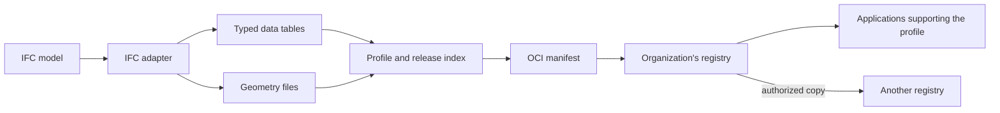

# Development

Run the commands in this guide from the repository root. Subsoil is a Rust
program that serves a file store, prepares model versions, and transfers them
between stores. Its browser pages are embedded in the binary.

## Build

The Nix development shell supplies the Rust tools and supporting programs:

```sh
nix develop
cargo build --locked --release
./target/release/subsoil --help
```

To build the packaged executable directly with Nix, run `nix build`. The result
is available as `./result/bin/subsoil`.

## Checks

The tests cover model conversion, file transfers, access rules, browser sign-in,
and persistence. Run the Rust checks, then exercise the two-store example with
ORAS and evaluate the Nix package:

```sh
cargo fmt --check
cargo clippy --locked --all-targets -- -D warnings
cargo test --locked
SUBSOIL_TEST_ORAS="$(command -v oras)" cargo test --locked --test showcase
nix flake check --no-build
git diff --check
```

When changing the logo, also run `python3 tools/build_brand.py --check` to check
that the exports match their masters. See the [brand guide](BRANDING.md) for
asset locations and regeneration.

## Connect a browser application

The file browser at `/explore` works without an external app registration. To
connect another browser application, register its client ID and exact callback
URL when starting Subsoil:

```sh
cargo run --locked -- user add --data build/registry writer \
  --grant project/model:pull,push
cargo run --locked -- serve --data build/registry --listen 127.0.0.1:5000 \
  --oauth-client-id model-client \
  --oauth-redirect-uri http://localhost:3000/oauth/callback
```

The application requests `subsoil:session` during PKCE sign-in, then exchanges the
approved root for concrete repository tokens at `/token`. The shared JSON policy
shape and share API are described in [AUTHORIZATION.md](AUTHORIZATION.md).

For direct browser API access, also pass `--cors-origin http://localhost:3000`.
Repeat `--cors-origin` for each trusted application origin. Registering an OAuth
callback alone does not enable CORS. See the [CORS deployment notes](DEPLOYMENT.md#direct-browser-access-with-cors)
for hosted applications and remembered-login constraints.

## Demo

The demo creates an example model, starts two local stores, and checks an
authenticated publish, copy, and receive workflow:

```sh
nix run .#demo -- --output build/showcase
```

It writes a report and the received files into the output folder. Choose a new
folder each time.

## Model format and transfer

Conversion reads an IFC model and produces typed data tables, geometry, and a
JSON release index. An OCI manifest describes these files for storage and
transfer. A profile defines how a receiving application interprets them.



The registry stores and delivers versions; applications interpret models, check
requirements, and calculate results. Other file types can use the same transfer
interface when applications support their profiles. Publisher and upload-time
metadata are stored separately from the manifest, preserving its content identity.

## Docker

The container includes the executable and its browser assets. A named volume
keeps account and file data between runs:

```sh
docker build -t subsoil:dev .
docker run --rm subsoil:dev --help
docker volume create subsoil-data
docker run --rm -it -v subsoil-data:/data subsoil:dev \
  user add --data /data writer --grant project/model:pull,push

docker run --rm -p 127.0.0.1:5000:5000 -v subsoil-data:/data subsoil:dev \
  serve --data /data --listen 0.0.0.0:5000 --public-url http://localhost:5000 \
  --oauth-client-id model-client \
  --oauth-redirect-uri http://localhost:3000/oauth/callback
```

Open the development registry as `http://localhost:5000`. For an HTTPS cloud
ingress, persistent storage and one-off provisioning jobs, see the
[deployment guide](DEPLOYMENT.md).
